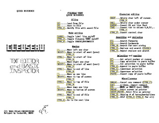
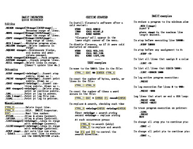

# Cleuseau Quick Reference

[cleuqr.pdf][] is a recreation of the quick reference pamphlet for
Polar Engineering's ROM2/Cleuseau option rom for the TRS-80 Model
100/102, Tandy 200, and NEC PC-8201. The [original scan][] was hard to
read so hackerb9 retyped it and made it available UTF-8 text, M100
text, and PDF.

[original scan]: original_scan.pdf
[cleuqr.pdf]: cleuqr.pdf

## Files 

* [cleuqr.pdf][]: The Cleuseau ROM Quick Reference in PDF format.
  Print to a double-sided sheet of US Letter paper to create a
  tri-fold pamphlet.

* [cleuqr.u8][]: The Cleuseau ROM Quick Reference in plain text format for
  modern computers (Unicode UTF-8 encoding).

* [CLEUQR.DO][]: The Cleuseau ROM Quick Reference in .DO text format for
  the TRS-80 Model 100 and Tandy 200 computers. 

* [original_scan.pdf](original_scan.pdf): A scan of the original quick
  reference sheet from 1985. It is hard to read and has a couple
  typos. Note that due to errors in the PDF file's metadata, it cannot
  be viewed on GitHub and will need to be downloaded.

[cleuqr.u8]: cleuqr.u8
[CLEUQR.DO]: CLEUQR.DO

## Errata corrected

A few minor changes were made to the document

* ASCII art title modified to fit better on a 40x8 (Model 100) or
  40x16 (Tandy 200) screen.
  
* Creator, date, and ASCII art of Inspector Jacques Clouseau added.

* `^L` (Form Feed) added between pages.

* SHIFT/CTRL plus ←/→ descriptions clarified.
  * SHIFT ← 
    * Original: _Move to start of word (left)_
	* Replacement:  _Move to start of word (prev)_
  * CTRL ← 
    * Original: _Move to end of line (left)_
	* Replacement:  _Move to start of line_
  * SHIFT →
    * Original: _Move to start of word (right)_
	* Replacement:  _Move to start of word (next)_
  * CTRL →
    * Original: _Move to end of line (right)_
	* Replacement:  _Move to end of line_

* Ensure that all lines have less than 40 characters to fit on M100 screen.
  * All lines on BASIC INSPECTOR page reduced by two dots (`..`).
  * Last line, _and the GOSUB/RETURN stack._, shifted left two more spaces.

* CALLs corrected
	* `CALL 911` corrected to match Cleuseau documentation:
    * Original: _To disable Cleuseau: CALL 911_
    * Replacement: _To access Cleuseau: CALL 911_
  * CALL to disable Cleuseau (`CALL 913,145`) added.
  * Tandy 200 CALL, NEC EXEC variants added.

